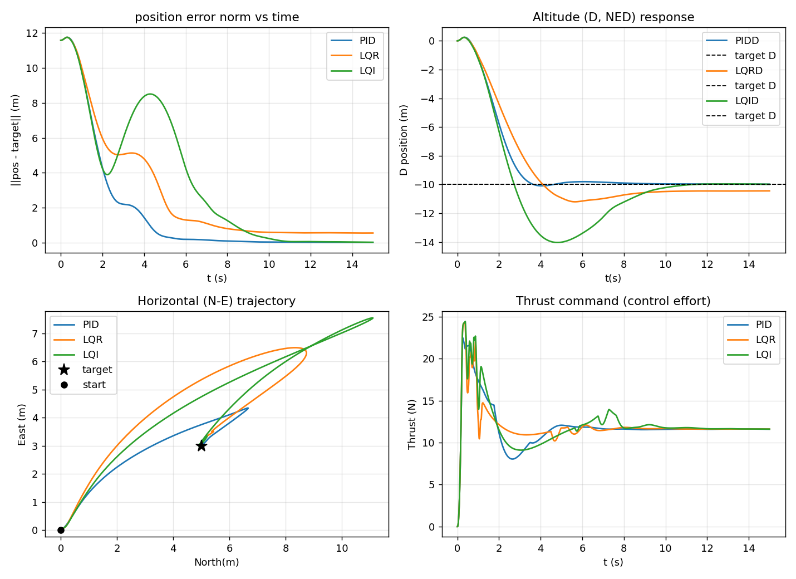
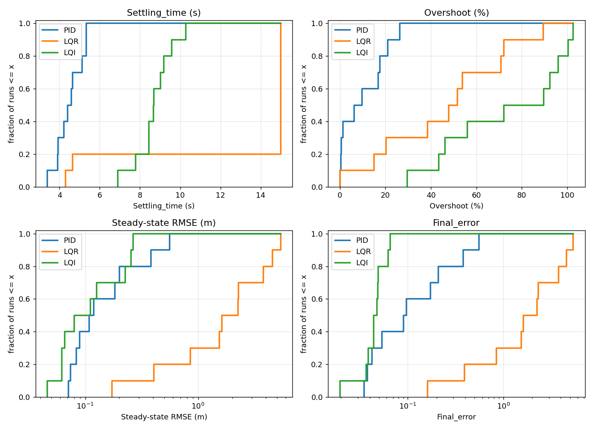
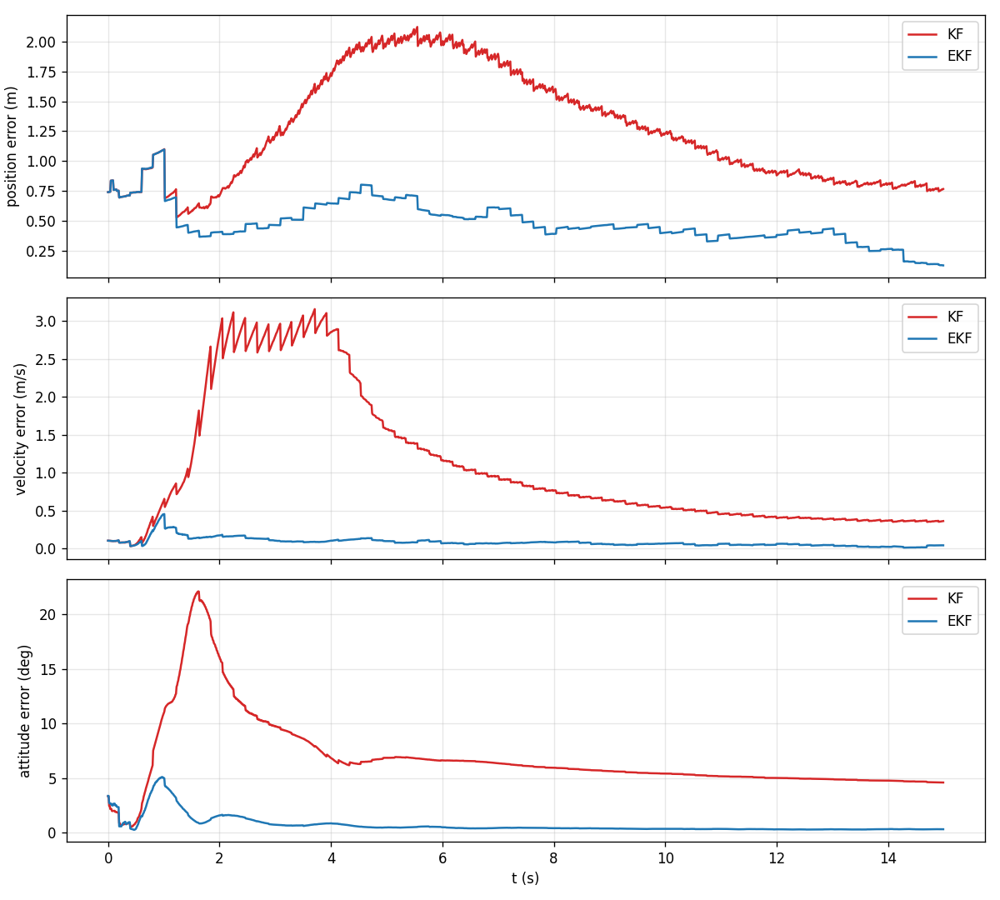
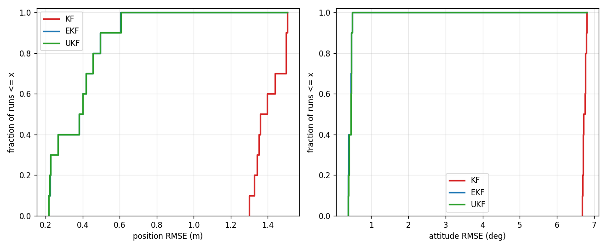

# 6-DOF UAV Simulator: Cascaded PID / LQR / LQI Control and KF / EKF / UKF State Estimation

[English](#english) | [Deutsch](#deutsch)

---

# English

## Overview

A from-scratch quadrotor simulation in Python (NumPy/SciPy/Matplotlib) with 6 degrees of freedom, three cascaded flight controllers (PID, LQR, LQI) and three state estimators (linear Kalman filter, extended Kalman filter, unscented Kalman filter). Built as a guidance, navigation and control (GNC) portfolio project.

## Features

- 6-DOF rigid-body dynamics (Newton-Euler), quaternion attitude, RK4 integration
- Motor model (first-order lag, saturation, rate limit) and quadrotor mixer
- Sensor models: IMU (white noise + bias random walk), GPS (5 Hz, noise, optional dropout), barometer, magnetometer
- Linearization about hover with open- and closed-loop eigenvalue analysis
- Cascaded controllers (position -> velocity -> attitude -> rate): PID, LQR, LQI (LQR with integral action)
- Wind (mean wind + correlated gusts), mass/inertia uncertainty, Monte Carlo analysis with ECDF plots
- State estimation: 9-state GPS/IMU/barometer/magnetometer filter implemented as KF (small-angle model), EKF (analytic Jacobians) and UKF (sigma points), with an NEES consistency check
- Unit tests and a script that records a demo video

## Project structure

```
uav_sim/
├── dynamics/      quaternion.py, rigid_body.py
├── actuators/     motor.py
├── sensors/       sensors.py
├── control/       linearize_lqr.py, pid_cascade.py, lqr_controller.py, lqi_controller.py
├── estimation/    filters.py, ins_models.py, ins_filters.py
├── sim/           simulate.py, analysis.py, run_estimation.py, demo_video.py
├── experiments/   mass_ablation.py, yaw_wind_diagnosis.py
├── tests/         test_dynamics.py, test_estimation.py
└── plots/         generated figures
```

## Installation

Python 3.10 or newer is required. Developed and tested with NumPy 2.2, SciPy 1.15 and Matplotlib 3.10.

```bash
git clone https://github.com/<your-username>/<your-repo>.git
cd <your-repo>
python3 -m venv venv
source venv/bin/activate
pip install -r requirements.txt
```

`ffmpeg` is optional (`sudo apt install ffmpeg`): with it the demo is written as MP4, without it as GIF.

## Usage

Run everything from the project root with `PYTHONPATH=.`:

```bash
export PYTHONPATH=.

python3 -m pytest tests -q -p no:cacheprovider   # unit tests
python3 control/linearize_lqr.py                 # open/closed-loop eigenvalues, LQR gains
python3 sim/simulate.py                          # one PID flight, prints the final position
python3 sim/analysis.py 10                       # PID vs LQR vs LQI Monte Carlo (10 trials, takes minutes)
python3 sim/run_estimation.py 10                 # flight + KF/EKF/UKF comparison (10 noise seeds)
python3 sim/demo_video.py                        # 3D demo video (python3 sim/demo_video.py 6 for a short test)
python3 experiments/mass_ablation.py             # LQR/PID under a wrong mass assumption
python3 experiments/yaw_wind_diagnosis.py        # 4 yaw/wind cases (takes a couple of minutes)
```

Generated figures are saved in `plots/`.

## How it works

- **Dynamics.** 13-element state (NED position, body-frame velocity, quaternion, body rates), integrated with RK4; the quaternion is renormalized every step.
- **Control.** Four nested loops (position -> velocity -> attitude -> rate). The tilt command is clipped as a combined magnitude, thrust is divided by cos(tilt) to hold altitude, and the horizontal acceleration command is rotated by the current yaw before it becomes a tilt command. LQR gains come from the Riccati equation on the linearized models. LQI augments the outer loop with the integral of the position error (9 states) and uses clamping plus freezing of the horizontal integrators while the tilt is saturated.
- **Estimation.** Nine states: position, velocity and Euler angles. The IMU drives the prediction; GPS, barometer and magnetometer correct it. The accelerometer is deliberately not used as a gravity reference, because on a quadrotor it senses the thrust direction. The KF uses a small-angle model with a time-varying transition matrix, the EKF uses analytic Jacobians (checked against finite differences in the tests), and the UKF uses sigma points (alpha = 1, beta = 2, kappa = 0).

## Results

**Controllers**: step to (5, 3, -10) m with yaw 0.5 rad, mean wind about (1.5, 1.0, 0) m/s plus gusts, nominal mass:

| Controller | Settling time (s) | Overshoot (%) | Steady-state RMSE (m) | Final error (m) |
|---|---|---|---|---|
| PID | 4.6 | 44.8 | 0.030 | 0.019 |
| LQR | 11.0 | 116.3 | 0.570 | 0.561 |
| LQI | 9.0 | 151.7 | 0.063 | 0.032 |

Overshoot is measured per axis relative to the step size and includes the effect of the wind pushing the vehicle past the target, so it should be read with care.

**Mass mismatch** (no wind; the controllers assume 1.2 kg), final error in N, E, D (m):

| True mass | PID | LQR |
|---|---|---|
| 1.20 kg | (-0.03, -0.02, 0.02) | (0.00, 0.00, 0.01) |
| 1.38 kg | (-0.03, -0.02, 0.04) | (0.00, 0.00, 2.80) |
| 1.02 kg | (-0.03, -0.03, -0.01) | (0.00, 0.00, -2.79) |

**Estimators**: one flight, t >= 2 s:

<!-- Replace these numbers with your own output of: python3 sim/run_estimation.py -->

| Filter | Position RMSE (m) | Velocity RMSE (m/s) | Attitude RMSE (deg) | Average NEES (ideal ~9) | Time per step (ms) |
|---|---|---|---|---|---|
| raw GPS | 2.34 | | | | |
| KF | 1.26 | 1.33 | 6.3 | 12703 | 0.03 |
| EKF | 0.47 | 0.039 | 0.15 | 7.8 | 0.10 |
| UKF | 0.47 | 0.039 | 0.16 | 7.8 | 0.7 |






## Key findings

1. Without an integrator, LQR leaves a steady offset under a constant disturbance or model error (wind: 0.56 m; 15 % mass error: about 2.8 m in altitude). PID and LQI remove it.
2. LQI brings the final error down to 0.03 m but approaches the target more slowly than PID.
3. Tilt commands must be rotated by the vehicle's current yaw. Without this, the LQR error at yaw 0.5 rad was 3.9 m; after the fix it was 0.01 m (no wind).
4. EKF and UKF agree closely and are statistically consistent. The UKF costs about 7 times more computation per step and gives no accuracy gain on this problem. The small-angle KF degrades with large tilt and yaw angles.

## Debugging notes

- The inner-loop LQR weights were first copied from the outer loop, which destroyed the time-scale separation of the cascade.
- A mistyped matrix slice in the process-noise matrix made all filters diverge; it was found by printing the nonzero entries of the matrix.
- The Jacobian unit tests compare the analytic Jacobian with a finite-difference derivative of the same function. They cannot detect an error in the process model itself. A noise-free dead-reckoning comparison against the simulator can.

## Limitations

- The controllers fly on the true state. The estimators run offline on the recorded flight; closing the loop with estimates is not implemented.
- The estimator has no sensor-bias states, uses Euler angles (singular at +/-90 deg pitch) and does not wrap the yaw angle.
- The estimation Monte Carlo varies sensor noise only; the flight is the same for every seed.
- Process-noise values were tuned by hand and checked with NEES, not optimized.

## Tests

`python3 -m pytest tests -q` runs the dynamics tests (quaternion algebra, rotation matrices, angular-momentum conservation, free fall) and the estimation tests (Jacobians against finite differences, KF/EKF/UKF equivalence on linear problems).

## Author and license

[Your Name]. Add a license (for example MIT) before others reuse the code.

---

# Deutsch

## Überblick

Eine von Grund auf in Python (NumPy/SciPy/Matplotlib) entwickelte Quadrocopter-Simulation mit 6 Freiheitsgraden, drei kaskadierten Flugreglern (PID, LQR, LQI) und drei Zustandsschätzern (lineares Kalman-Filter, erweitertes Kalman-Filter, Unscented Kalman-Filter). Das Projekt entstand als Portfolio-Projekt im Bereich Guidance, Navigation & Control (GNC).

## Funktionen

- Starrkörperdynamik mit 6 Freiheitsgraden (Newton-Euler), Lage als Quaternion, RK4-Integration
- Motormodell (Verzögerung 1. Ordnung, Sättigung, Änderungsratenbegrenzung) und Quadrocopter-Mixer
- Sensormodelle: IMU (weißes Rauschen + Bias als Random Walk), GPS (5 Hz, Rauschen, optionale Ausfälle), Barometer, Magnetometer
- Linearisierung um den Schwebeflug mit Eigenwertanalyse im offenen und geschlossenen Regelkreis
- Kaskadenregler (Position -> Geschwindigkeit -> Lage -> Drehrate): PID, LQR, LQI (LQR mit Integralanteil)
- Wind (Mittelwind + korrelierte Böen), Unsicherheit von Masse und Trägheit, Monte-Carlo-Analyse mit ECDF-Diagrammen
- Zustandsschätzung: 9-Zustands-Filter mit GPS, IMU, Barometer und Magnetometer als KF (Kleinwinkelmodell), EKF (analytische Jacobi-Matrizen) und UKF (Sigma-Punkte), mit NEES-Konsistenzprüfung
- Unit-Tests und ein Skript zur Aufnahme eines Demo-Videos

## Projektstruktur

```
uav_sim/
├── dynamics/      quaternion.py, rigid_body.py
├── actuators/     motor.py
├── sensors/       sensors.py
├── control/       linearize_lqr.py, pid_cascade.py, lqr_controller.py, lqi_controller.py
├── estimation/    filters.py, ins_models.py, ins_filters.py
├── sim/           simulate.py, analysis.py, run_estimation.py, demo_video.py
├── experiments/   mass_ablation.py, yaw_wind_diagnosis.py
├── tests/         test_dynamics.py, test_estimation.py
└── plots/         erzeugte Diagramme
```

## Installation

Python 3.10 oder neuer ist erforderlich. Entwickelt und getestet mit NumPy 2.2, SciPy 1.15 und Matplotlib 3.10.

```bash
git clone https://github.com/<ihr-benutzername>/<ihr-repo>.git
cd <ihr-repo>
python3 -m venv venv
source venv/bin/activate
pip install -r requirements.txt
```

`ffmpeg` ist optional (`sudo apt install ffmpeg`): Mit ffmpeg wird das Demo als MP4 gespeichert, ohne ffmpeg als GIF.

## Verwendung

Alle Befehle werden im Projektverzeichnis mit `PYTHONPATH=.` ausgeführt:

```bash
export PYTHONPATH=.

python3 -m pytest tests -q -p no:cacheprovider   # Unit-Tests
python3 control/linearize_lqr.py                 # Eigenwerte offen/geschlossen, LQR-Verstärkungen
python3 sim/simulate.py                          # ein PID-Flug, gibt die Endposition aus
python3 sim/analysis.py 10                       # Monte-Carlo-Vergleich PID/LQR/LQI (10 Läufe, dauert Minuten)
python3 sim/run_estimation.py 10                 # Flug + Vergleich KF/EKF/UKF (10 Rausch-Seeds)
python3 sim/demo_video.py                        # 3D-Demo-Video (python3 sim/demo_video.py 6 für einen kurzen Test)
python3 experiments/mass_ablation.py             # LQR/PID bei falsch angenommener Masse
python3 experiments/yaw_wind_diagnosis.py        # 4 Fälle mit Gierwinkel/Wind (dauert einige Minuten)
```

Die erzeugten Diagramme werden in `plots/` gespeichert.

## Funktionsweise

- **Dynamik.** Zustandsvektor mit 13 Elementen (Position in NED, Geschwindigkeit im Körperkoordinatensystem, Quaternion, Drehraten), integriert mit RK4; das Quaternion wird in jedem Schritt neu normiert.
- **Regelung.** Vier verschachtelte Regelkreise (Position -> Geschwindigkeit -> Lage -> Drehrate). Der Neigungsbefehl wird als Gesamtbetrag begrenzt, der Schub wird durch cos(Neigung) geteilt, um die Höhe zu halten, und der horizontale Beschleunigungsbefehl wird vor der Umrechnung in Neigungswinkel mit dem aktuellen Gierwinkel gedreht. Die LQR-Verstärkungen stammen aus der Riccati-Gleichung der linearisierten Modelle. Beim LQI wird der äußere Regelkreis um das Integral des Positionsfehlers erweitert (9 Zustände); dazu kommen Begrenzung des Integrators und Einfrieren der horizontalen Integratoren, solange die Neigung gesättigt ist.
- **Zustandsschätzung.** Neun Zustände: Position, Geschwindigkeit und Euler-Winkel. Die IMU treibt die Prädiktion an; GPS, Barometer und Magnetometer korrigieren sie. Der Beschleunigungssensor wird bewusst nicht als Schwerkraftreferenz verwendet, weil er bei einem Quadrocopter die Schubrichtung misst. Das KF nutzt ein Kleinwinkelmodell mit zeitvarianter Übergangsmatrix, das EKF analytische Jacobi-Matrizen (in den Tests mit finiten Differenzen geprüft) und das UKF Sigma-Punkte (alpha = 1, beta = 2, kappa = 0).

## Ergebnisse

**Regler**: Sprung auf (5, 3, -10) m mit Gierwinkel 0,5 rad, Mittelwind etwa (1,5; 1,0; 0) m/s plus Böen, nominelle Masse:

| Regler | Ausregelzeit (s) | Überschwingen (%) | RMSE im eingeschwungenen Zustand (m) | Endfehler (m) |
|---|---|---|---|---|
| PID | 4,6 | 44,8 | 0,030 | 0,019 |
| LQR | 11,0 | 116,3 | 0,570 | 0,561 |
| LQI | 9,0 | 151,7 | 0,063 | 0,032 |

Das Überschwingen wird pro Achse relativ zur Sprunghöhe gemessen und enthält auch den Einfluss des Windes, der das Fahrzeug über das Ziel hinausdrückt; es sollte daher mit Vorsicht gelesen werden.

**Falsche Masse** (kein Wind; die Regler nehmen 1,2 kg an), Endfehler in N, E, D (m):

| Tatsächliche Masse | PID | LQR |
|---|---|---|
| 1,20 kg | (-0,03; -0,02; 0,02) | (0,00; 0,00; 0,01) |
| 1,38 kg | (-0,03; -0,02; 0,04) | (0,00; 0,00; 2,80) |
| 1,02 kg | (-0,03; -0,03; -0,01) | (0,00; 0,00; -2,79) |

**Schätzer**: ein Flug, t >= 2 s:

<!-- Diese Zahlen durch die eigene Ausgabe von python3 sim/run_estimation.py ersetzen -->

| Filter | Positions-RMSE (m) | Geschwindigkeits-RMSE (m/s) | Lage-RMSE (Grad) | mittlerer NEES (ideal ca. 9) | Zeit pro Schritt (ms) |
|---|---|---|---|---|---|
| reines GPS | 2,34 | | | | |
| KF | 1,26 | 1,33 | 6,3 | 12703 | 0,03 |
| EKF | 0,47 | 0,039 | 0,15 | 7,8 | 0,10 |
| UKF | 0,47 | 0,039 | 0,16 | 7,8 | 0,7 |


## Wichtigste Erkenntnisse

1. Ohne Integrator hinterlässt der LQR bei konstanter Störung oder Modellfehler eine bleibende Regelabweichung (Wind: 0,56 m; 15 % Massenfehler: etwa 2,8 m in der Höhe). PID und LQI beseitigen sie.
2. Der LQI senkt den Endfehler auf 0,03 m, nähert sich dem Ziel aber langsamer als der PID.
3. Neigungsbefehle müssen mit dem aktuellen Gierwinkel des Fahrzeugs gedreht werden. Ohne diese Korrektur lag der LQR-Fehler bei Gierwinkel 0,5 rad bei 3,9 m; danach bei 0,01 m (kein Wind).
4. EKF und UKF stimmen eng überein und sind statistisch konsistent. Das UKF braucht etwa 7-mal mehr Rechenzeit pro Schritt und bringt bei diesem Problem keinen Genauigkeitsgewinn. Das Kleinwinkel-KF verschlechtert sich bei großen Neigungs- und Gierwinkeln.

## Hinweise zur Fehlersuche

- Die Gewichte des inneren LQR-Regelkreises wurden zunächst vom äußeren Regelkreis kopiert, wodurch die Zeitskalentrennung der Kaskade verloren ging.
- Ein falsch getippter Matrix-Ausschnitt in der Prozessrauschmatrix ließ alle Filter divergieren; gefunden wurde er, indem die von Null verschiedenen Einträge der Matrix ausgegeben wurden.
- Die Jacobi-Unit-Tests vergleichen die analytische Jacobi-Matrix mit der numerischen Ableitung derselben Funktion. Einen Fehler im Prozessmodell selbst können sie nicht erkennen. Das kann ein rauschfreier Dead-Reckoning-Vergleich mit dem Simulator.

## Einschränkungen

- Die Regler fliegen mit dem wahren Zustand. Die Schätzer laufen offline auf dem aufgezeichneten Flug; das Schließen des Regelkreises mit den Schätzwerten ist nicht umgesetzt.
- Der Schätzer hat keine Sensor-Bias-Zustände, verwendet Euler-Winkel (singulär bei +/-90 Grad Nickwinkel) und wickelt den Gierwinkel nicht um.
- Die Monte-Carlo-Analyse der Schätzung variiert nur das Sensorrauschen; der Flug ist für jeden Seed derselbe.
- Die Prozessrauschwerte wurden von Hand eingestellt und mit dem NEES geprüft, nicht optimiert.

## Tests

`python3 -m pytest tests -q` führt die Dynamik-Tests (Quaternion-Algebra, Rotationsmatrizen, Drehimpulserhaltung, freier Fall) und die Schätzer-Tests (Jacobi-Matrizen gegen finite Differenzen, Gleichheit von KF/EKF/UKF bei linearen Problemen) aus.

## Autor und Lizenz

[Ihr Name]. Bitte eine Lizenz (zum Beispiel MIT) hinzufügen, bevor andere den Code wiederverwenden.
